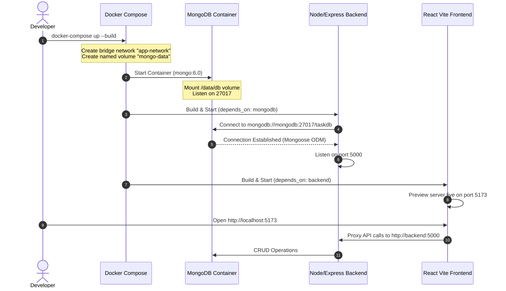

# Practical 11: Containerization with Docker and Docker Compose

**Course**: ADVANCED WEB DEVELOPMENT FRAMEWORKS (ITUE301)  
**Institution**: CHAROTAR UNIVERSITY OF SCIENCE AND TECHNOLOGY (CHARUSAT)  
**Faculty**: FACULTY OF TECHNOLOGY AND ENGINEERING  
**Department**: B. TECH (IT/CE/CSE/AIML)  
**Course Outcomes**: **CO5** (Containerize full-stack web applications and orchestrate multi-container environments using Docker and Docker Compose)  
**Program Outcomes**: **PO3** (Design/development of solutions), **PO5** (Modern tool usage)  

---

## 🎯 Problem Definition & Academic Objectives

### Objective
To containerize the full-stack Task Management application (React frontend, Node/Express backend, and MongoDB database) using Docker and orchestrate all services seamlessly using Docker Compose with a single command.

### Core Problem Statement
1. **Frontend Dockerfile**: Author an optimized Dockerfile for the React/Vite frontend.
2. **Backend Dockerfile**: Author a Dockerfile for the Node/Express REST API backend.
3. **Multi-Service Orchestration (`docker-compose.yml`)**: Create a unified `docker-compose.yml` file orchestrating all 3 services: `frontend`, `backend`, and `mongodb`.
4. **Inter-Container Networking & Port Mapping**: Configure host-to-container port mappings and an internal bridge network (`app-network`) allowing containers to communicate securely by service name.
5. **Zero-Manual-Step Startup**: The entire multi-tier stack must boot reliably using a single `docker-compose up --build` command without requiring manual database initialization or environment interventions.

### Supplementary Problems
1. **`.dockerignore` Optimization**: Add `.dockerignore` files to both frontend and backend to exclude `node_modules`, `.env`, and build artifacts from Docker's build context.
2. **Multi-Stage Build**: Implement a multi-stage build for the React frontend to minimize final image footprint.
3. **Named Storage Volume**: Attach a named Docker volume (`mongo-data`) to MongoDB so database records persist across container destruction and restarts.

---

## 📚 Theory Concepts & Coursera Self-Study Reference

### 1. References
- **Week 11 IBM Coursera**: *Introduction to Containers with Docker, Kubernetes & OpenShift* (Modules on Docker fundamentals, image layers, Dockerfiles, and Docker Compose orchestration).
- **Docker Documentation**: *Networking in Compose, Storage Volumes, and Multi-Stage Builds*.

### 2. Containerization vs Traditional Virtualization
| Parameter | Bare-Metal / Local Machine | Traditional Virtual Machines (VM) | Docker Containers |
| :--- | :--- | :--- | :--- |
| **Isolation** | Shared OS, potential port conflicts (`EADDRINUSE`), "works on my machine" syndrome. | Heavyweight Hypervisor running full Guest OS. | Lightweight process isolation sharing the host Linux kernel via cgroups & namespaces. |
| **Startup Latency** | Manual setup of Node, Mongo, npm dependencies. | 1 to 5 minutes. | **1 to 5 seconds**. |
| **Resource Overhead** | Variable based on host background services. | High RAM/Disk consumption (GBs per VM). | Negligible (MBs per container). |
| **Reproducibility** | Fragile across developer machines. | Medium. | **100% Deterministic & Immutable**. |

---

## 📐 Architecture & Orchestration Diagrams

### 1. Multi-Container Orchestration Architecture
```
                                 HOST MACHINE (Browser / Developer)
                                                 │
                   ┌─────────────────────────────┴─────────────────────────────┐
                   │ Port 5173                                                 │ Port 5000
                   ▼                                                           ▼
      ┌─────────────────────────┐                                 ┌─────────────────────────┐
      │     awdf-frontend       │                                 │      awdf-backend       │
      │  (React 18 + Vite SPA)  │                                 │   (Express REST API)    │
      │  Container Port: 5173   │                                 │   Container Port: 5000  │
      └────────────┬────────────┘                                 └────────────┬────────────┘
                   │                                                           │
                   │                                                           │
                   │               DOCKER BRIDGE NETWORK: app-network          │
                   └─────────────────────────────┬─────────────────────────────┘
                                                 │
                                                 │ mongodb://mongodb:27017/taskdb
                                                 ▼
                                    ┌─────────────────────────┐
                                    │      awdf-mongodb       │
                                    │    (Official Mongo 6)   │
                                    │  Container Port: 27017  │
                                    └────────────┬────────────┘
                                                 │
                                                 ▼
                                    ┌─────────────────────────┐
                                    │   NAMED DOCKER VOLUME   │
                                    │       mongo-data        │
                                    │  (Persists to host disk)│
                                    └─────────────────────────┘
```

### 2. Startup Lifecycle Sequence


---

## 🔬 In-Depth Analysis: Key Questions Answered

### Question 1: Why does the backend container need to reference the MongoDB container by its service name (e.g., `mongodb`) rather than `localhost`?
**Answer**:
1. **Isolated Linux Network Namespaces**: In Docker, each container runs inside its own isolated network namespace with its own virtual network interface (`eth0`) and its own private loopback interface (`lo` / `127.0.0.1`).
2. **The Meaning of `localhost`**: Inside the backend container, `localhost` or `127.0.0.1` refers strictly to the backend container itself. Since the MongoDB daemon is running in a different container, querying `localhost:27017` from the backend will result in `ECONNREFUSED` (no MongoDB daemon is listening on the backend's local loopback).
3. **Docker Embedded DNS Server (`127.0.0.11`)**: When containers are connected to a user-defined bridge network (such as `app-network`), Docker provides an automatic embedded DNS service. Whenever the backend resolves `mongodb`, Docker's internal DNS dynamically translates the service name into the private internal IP address assigned to the MongoDB container (e.g., `172.20.0.2`).

### Question 2: What is the difference between `EXPOSE` in a Dockerfile and the `ports` mapping in `docker-compose.yml`?
**Answer**:
| Feature | `EXPOSE` (Dockerfile) | `ports` (docker-compose.yml) |
| :--- | :--- | :--- |
| **Purpose** | Documentation & Metadata declaration. | Active Network Port Forwarding. |
| **Host Accessibility** | **NO host access**. The port is NOT published to the host computer's interfaces. | **YES**. Maps a host port to the container port (e.g., `"5000:5000"`). |
| **OS Implementation** | Adds a metadata label to the Docker image manifest (`ContainerConfig.ExposedPorts`). | Configures host Linux/Windows `iptables` / NAT packet forwarding rules. |
| **Inter-Container Access** | Containers on the same bridge network can communicate on any port regardless of `EXPOSE`. | Required only when external traffic (such as your host browser or Postman) needs access. |

### Question 3: Why is it considered bad practice to copy `node_modules` into a Docker image instead of running `npm install` inside the container?
**Answer**:
1. **OS and Architecture Binary Incompatibility**: Many Node.js packages (such as `bcrypt`, `sharp`, `canvas`, or `fsevents`) compile native C/C++ bindings during installation via `node-gyp`. If `node_modules` is copied from a Windows host machine (`x64-win32-pe`) into a Linux Alpine container (`x64-linux-musl`), the compiled `.node` shared objects fail to execute, causing instant runtime crashes (`ERR_DLOPEN_FAILED: invalid ELF header`).
2. **Massive Build Context Overhead**: Local `node_modules` folders typically contain tens of thousands of files and consume 300MB–800MB. Copying them over the Docker daemon socket severely slows down the initial build context transfer.
3. **Dirty Local State**: Local installations may contain cached dev-dependencies, test symlinks, or operating-system-specific cache files that pollute the immutable production image.
4. **Best Practice Solution**: Exclude `node_modules` via `.dockerignore` and execute `RUN npm install --production` inside the container Linux environment.

---

## 🛠️ Step-by-Step Implementation Files

### 1. Backend Dockerfile (`backend/Dockerfile`)
```dockerfile
FROM node:18-alpine

WORKDIR /app

# Copy dependency manifests first (Optimizes Docker Layer Caching)
COPY package*.json ./

# Install dependencies in the target Linux architecture
RUN npm install --production

# Copy application source code
COPY . .

# Expose backend REST port
EXPOSE 5000

CMD ["node", "server.js"]
```

### 2. Frontend Multi-Stage Dockerfile (`frontend/Dockerfile`)
```dockerfile
# Stage 1: Build the React Application
FROM node:18-alpine AS build

WORKDIR /app

COPY package*.json ./
RUN npm install

COPY . .
RUN npm run build

EXPOSE 5173

# Launch preview server bound to all network interfaces for container networking
CMD ["npm", "run", "preview", "--", "--host", "0.0.0.0", "--port", "5173"]
```

### 3. Supplementary: Frontend Multi-Stage Nginx Build (`frontend/Dockerfile.nginx`)
```dockerfile
# Stage 1: Build Phase
FROM node:18-alpine AS builder
WORKDIR /app
COPY package*.json ./
RUN npm install
COPY . .
RUN npm run build

# Stage 2: Production Serving Phase (Reduces image from ~450MB down to ~25MB!)
FROM nginx:alpine
COPY --from=builder /app/dist /usr/share/nginx/html
COPY nginx.conf /etc/nginx/conf.d/default.conf

EXPOSE 5173
CMD ["nginx", "-g", "daemon off;"]
```

### 4. Root `docker-compose.yml`
```yaml
version: '3.8'

services:
  mongodb:
    image: mongo:6.0
    container_name: taskflow-mongodb
    restart: unless-stopped
    ports:
      - "27017:27017"
    environment:
      - MONGO_INITDB_DATABASE=taskdb
    volumes:
      - mongo-data:/data/db
    networks:
      - app-network

  backend:
    build:
      context: ./backend
      dockerfile: Dockerfile
    container_name: taskflow-backend
    restart: unless-stopped
    ports:
      - "5000:5000"
    environment:
      - NODE_ENV=production
      - PORT=5000
      - MONGO_URI=mongodb://mongodb:27017/taskdb
      - JWT_SECRET=supersecret_jwt_key_practical11_awdf_2026
      - JWT_EXPIRE=2h
    depends_on:
      - mongodb
    networks:
      - app-network

  frontend:
    build:
      context: ./frontend
      dockerfile: Dockerfile
    container_name: taskflow-frontend
    restart: unless-stopped
    ports:
      - "5173:5173"
    environment:
      - VITE_BACKEND_URL=http://backend:5000
    depends_on:
      - backend
    networks:
      - app-network

networks:
  app-network:
    name: app-network
    driver: bridge

volumes:
  mongo-data:
    name: taskflow-mongo-data
    driver: local
```

### 5. Exclusion Rules (`.dockerignore`)
Placed in both `backend/.dockerignore` and `frontend/.dockerignore`:
```
node_modules
npm-debug.log
.env
.git
dist
*.log
```

---

## 🚀 Execution & Verification Commands

### Step 1: Verify Docker Installation
```bash
docker --version
docker compose version
```

### Step 2: Build & Start the Full Stack (Single Command)
```bash
docker compose up --build -d
```

### Step 3: Verify All 3 Containers Are Running
```bash
docker compose ps
```
**Expected Output**:
```
NAME                IMAGE                    COMMAND                  SERVICE             CREATED             STATUS              PORTS
taskflow-mongodb    mongo:6.0                "docker-entrypoint.s…"   mongodb             20 seconds ago      Up 20 seconds       0.0.0.0:27017->27017/tcp
taskflow-backend    practical-11-backend     "docker-entrypoint.s…"   backend             15 seconds ago      Up 15 seconds       0.0.0.0:5000->5000/tcp
taskflow-frontend   practical-11-frontend    "docker-entrypoint.s…"   frontend            10 seconds ago      Up 10 seconds       0.0.0.0:5173->5173/tcp
```

### Step 4: Verify Backend Health & Database Link
```bash
curl http://localhost:5000/api/health
```
**Response**:
```json
{
  "status": "UP",
  "service": "Practical 11 Docker & Docker Compose Containerized Backend",
  "database": "MongoDB (taskdb on mongodb:27017)",
  "environment": "production"
}
```

### Step 5: Verify Data Persistence (Named Volume Verification)
1. Create a task via Frontend (`http://localhost:5173`) or API.
2. Stop and remove containers:
   ```bash
   docker compose down
   ```
3. Restart containers:
   ```bash
   docker compose up -d
   ```
4. Query tasks again: All records remain intact because `mongo-data` persisted data on host storage!

---

## 🛠️ Troubleshooting Guide

| Symptom | Likely Cause | Solution / Fix |
| :--- | :--- | :--- |
| **Backend cannot connect to MongoDB** | Connection string uses `localhost` instead of Compose service name `mongodb`. | Update `MONGO_URI` to `mongodb://mongodb:27017/taskdb` in `docker-compose.yml`. |
| **Port already in use error (`EADDRINUSE`)** | A previous container or local background process is bound to port 5000, 5173, or 27017. | Run `docker ps` to stop conflicting containers, or change host port mapping (e.g. `"5001:5000"`). |
| **Docker build is extremely slow** | `node_modules` or `.git` is being transmitted in the build context. | Add a `.dockerignore` file excluding `node_modules` and `.env`. |
| **Code changes not reflected after restart** | Old cached image layers are being reused by Docker. | Run `docker compose up --build` to force rebuild of updated layers. |

---

## 🎓 Evaluation Rubrics & Viva Questions

### Viva Questions & Answers
1. **Q: What is a multi-stage Docker build, and why is it valuable?**  
   *A*: A multi-stage build uses multiple `FROM` instructions in a single Dockerfile. Heavy build tools (Node.js, devDependencies, compilers) are isolated to early stages, and only the final compiled static output (e.g. `dist/`) is copied into a clean, lightweight production image (e.g. `nginx:alpine`). This reduces image size by over 90%.
2. **Q: What is the difference between a bind mount and a named volume?**  
   *A*: A bind mount maps an exact file or directory path from the host machine to the container (often used for live code reloading in development). A named volume is completely managed by Docker in a dedicated storage area (`/var/lib/docker/volumes`), providing better performance, security, and portability across host environments.
3. **Q: What is the difference between `docker-compose stop`, `docker-compose down`, and `docker-compose down -v`?**  
   *A*: `stop` pauses container execution without removing containers or networks. `down` stops and destroys containers, networks, and internal links. `down -v` destroys containers, networks, AND deletes all attached named volumes (erasing persistent database data).

### Evaluation Rubrics (10 Marks)
- **Conceptual understanding (2 Marks)**: Container isolation, networking namespaces, DNS resolution, and layer caching.
- **Implementation (4 Marks)**: Multi-stage Dockerfiles, clean `docker-compose.yml`, `.dockerignore`, and service definitions.
- **Correctness (2 Marks)**: Single-command startup (`docker-compose up --build`) with full end-to-end communication across frontend, backend, and MongoDB.
- **Reflection (1 Mark)**: Documentation of troubleshooting scenarios and Docker storage volume persistence.
- **Lab file evidence (1 Mark)**: Complete repository structure, bash/bat runner scripts, and comprehensive README documentation.

